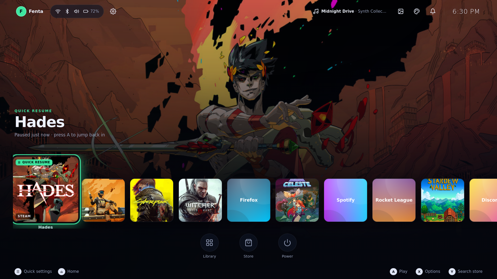
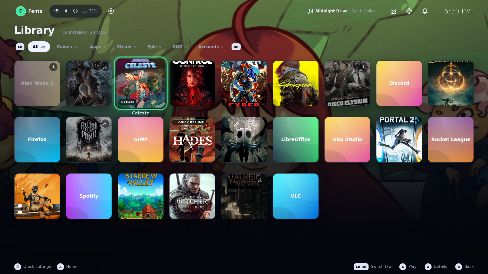
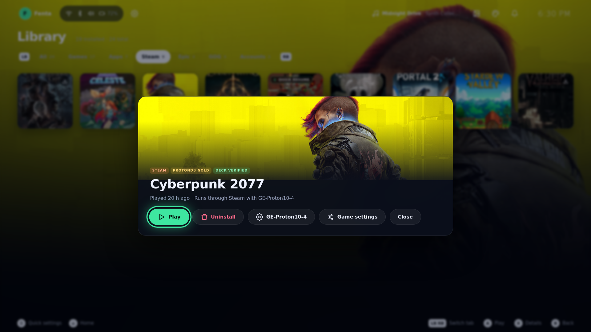
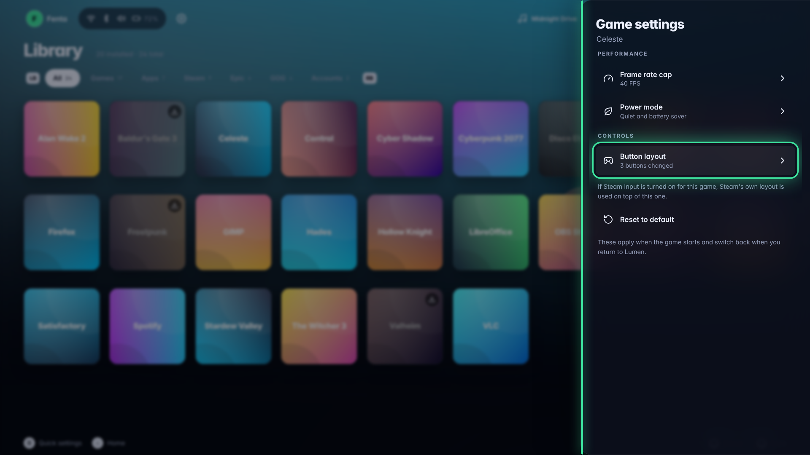
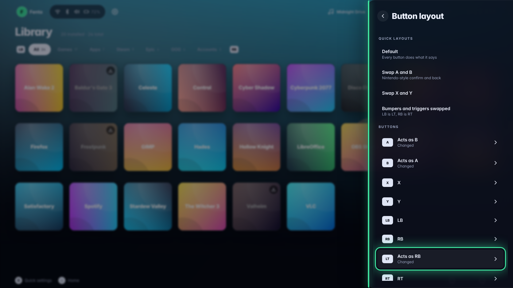
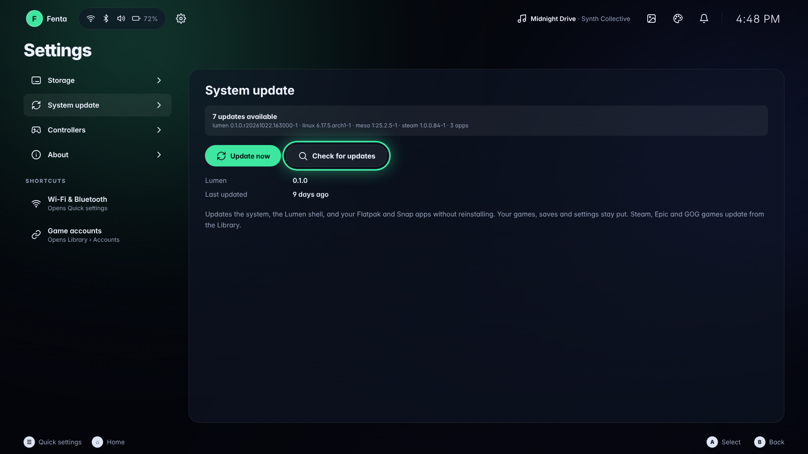
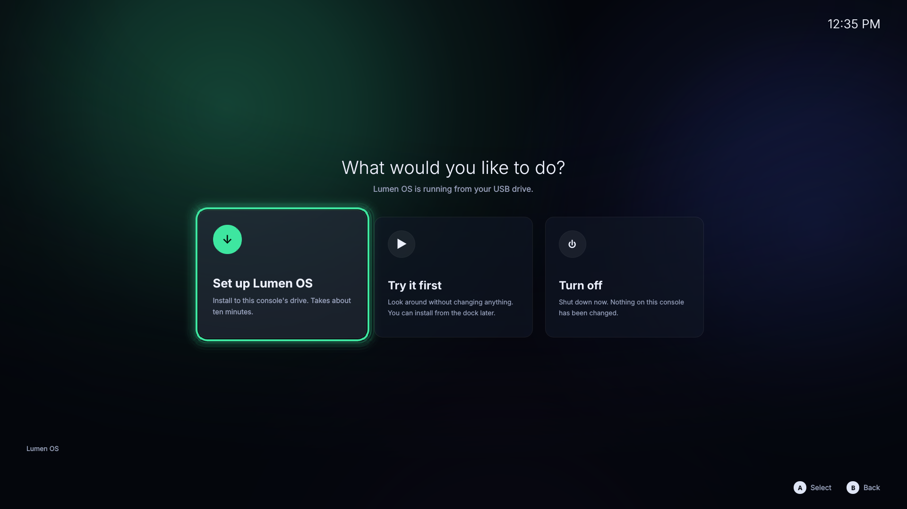
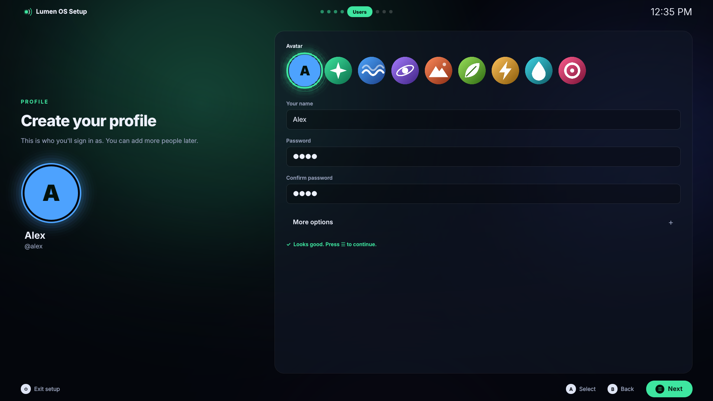

# Lumen OS

An Arch-based Linux distro that boots straight into a console-style shell.
Think of the Xbox 360 blades, rebuilt for today: dark glass panels that slide
in from the edges, big tiles, one accent colour, and no desktop. It works with
a controller, a mouse, or a keyboard.



> **Status: early and mostly untested on real hardware.** The shell is
> developed and screenshotted against mock data in a browser, the ISO is built
> and booted in QEMU by CI, and the installer screens are rendered offline. No
> one has yet installed Lumen on a real PC or booted the PS5 image on a real
> console. See [What has and hasn't been tested](#what-has-and-hasnt-been-tested).

## What's in it

**Top bar.** The left side is you: your account (switch user, sign out),
Quick Settings (Wi-Fi, Bluetooth, sound, brightness, battery, airplane mode)
and the Settings gear. The right side is for fun: the music player,
screenshot album, themes, notifications and the clock.

**Home** shows your 15 most recent games and apps in one row, followed by an
*All software* tile. The dock below it has Library, Store and Power.

**Library** is a Switch-style grid of every game and app, with a filter per
source. It brings Steam, Epic Games and GOG together with your regular
desktop apps.



**Game art.** Every game gets real cover art, and on Home and in the Library
the background changes to the focused game's artwork. Steam games use Steam's
own images. Epic, GOG and desktop games are matched to Steam by title in the
background, falling back to the store's own images and then a generated
cover. Art is downloaded once into `~/.cache/lumen/art`, so it keeps working
offline. Apps keep the normal background.



**Launcher accounts.** Connect Steam, Epic and GOG under Library › Accounts.
Steam games run through the Steam client and its own Proton. Epic games
(through `legendary`) and GOG games (through `gogdl`) download into
`~/Games/<store>/` and run with GE-Proton through `umu-run`, each in its own
Wine prefix under `~/Games/Prefixes/`. Plain Wine is installed too, for the
odd game that runs better outside Proton.

**Game settings** (a game's details › Game settings) gives each game its own
frame rate cap (30 to 120 FPS), power mode (Performance, Balanced, or Quiet
and battery saver) and button layout (swap A/B, X/Y, bumpers and triggers, or
remap any single button or turn it off). They switch on when the game starts
and back off when you return to Lumen. The cap is set through gamescope, so
it works for Steam games too; power modes use power-profiles-daemon and
button layouts use InputPlumber.

<p>
  
  
</p>

**Store** searches Flathub and the Snap Store at the same time and merges the
results. An app that is in both shows once, preferring Flatpak. The app page
has the icon, description, screenshots and which source it installs from.

**Sign-in** is a PS5-style "Who's playing?" user picker with avatars and an
optional PIN or password, running on greetd.

**System update** (Settings › System update) updates the OS, the Lumen shell
and your Flatpak and Snap apps in place, without reinstalling. Games, saves
and settings stay put. The shell and the packages Lumen builds from the AUR
come from the `[lumen]` pacman repo, which CI publishes to the `lumen-repo`
release on every push to `main`.



**Installer.** The ISO starts on a console-style power-on screen with
**Set up Lumen OS**, **Try it first** and **Turn off**. Setup is Calamares
with a custom QML theme that matches the shell: language, region, keyboard,
disk, profile (avatar, name, password or PIN), summary and install, all
driveable with a controller and an on-screen keyboard. See
[installer/README.md](installer/README.md).

<p>
  
  
</p>

Under the hood the session runs on gamescope, like SteamOS. The UI is plain
HTML, CSS and ES modules in a Chromium kiosk, backed by `lumend`, a small
Python daemon (standard library only). See
[docs/ROADMAP.md](docs/ROADMAP.md) for the architecture.

More screenshots: [sign-in](docs/screenshots/01-sign-in.png),
[Quick Settings](docs/screenshots/05-quick-settings.png),
[accounts](docs/screenshots/11-accounts.png),
[store](docs/screenshots/13-store.png),
[store app page](docs/screenshots/14-store-app.png),
[on-screen keyboard](docs/screenshots/17-onscreen-keyboard.png).

## Download

Builds come from GitHub Actions. Artifacts are kept for 14 days; if the
latest one has expired, start the workflow again from the Actions tab
(**Run workflow**).

| Image | Workflow | Artifact | For |
| --- | --- | --- | --- |
| `lumen-*.iso` + `SHA256SUMS` | **Build ISO** | `lumen-iso` | x86_64 PCs. Write it to a USB stick and boot it. Installing needs UEFI. |
| `lumen-ps5.img.xz` + `SHA256SUMS` | **Build PS5 image** | `lumen-ps5` | Jailbroken PS5 on firmware 13.60 (also 3.00 – 7.61) |

To download: open **Actions**, pick the latest green run of the workflow on
`main`, and download the artifact at the bottom of the run page (you need to
be signed in to GitHub).

### PlayStation 5

The PS5 build is a USB image booted by the
[ps5-linux](https://github.com/ps5-linux) loader on top of a jailbreak. It
runs the same shell, power-on screen and setup on the ps5-linux kernel,
without the disk step. It is **experimental**: Linux on 13.60 is brand new,
standby doesn't work, Wi-Fi works only on Marvell chips, and some TVs need a
`cmdline.txt` tweak. Every time the console is turned on it starts the PS5
system software, so you run the jailbreak and loader again to get back into
Lumen. Full steps and troubleshooting are in [ps5/README.md](ps5/README.md).

## Try the shell in a browser

No Arch system needed, just Python 3:

```sh
make dev        # serves fake data on http://127.0.0.1:7777/
```

Open `http://127.0.0.1:7777/` for the shell and
`http://127.0.0.1:7777/?mode=greeter` for the sign-in screen. Arrow keys move,
Enter selects, Esc goes back, F1 opens Quick Settings, `[` and `]` switch tabs.
A connected controller works too. Game art is fetched from Steam for real, so
you need a network connection to see covers.

## Test

```sh
make test       # lumend unit tests (Python standard library only)
```

CI also checks the following on its own:

| Workflow | What it does |
| --- | --- |
| **Build ISO** | Runs `make test`, builds the ISO in an Arch container, publishes the `[lumen]` pacman repo (on `main`), then boots the ISO in QEMU and screenshots it to the `vm-screenshots` branch |
| **Build PS5 image** | Builds the ps5-linux kernel package (cached per pinned commit) and the USB image. Nothing boots it, since it needs a real console |
| **UI screenshots** | On pull requests that touch the shell, runs `lumend` with mock data and screenshots every screen with Playwright to the `ui-screenshots` branch |

The installer screens can be rendered without Calamares or Arch:

```sh
python -m venv .venv && .venv/bin/pip install PySide6
.venv/bin/python installer/preview/preview.py installer/preview/out
```

## Build

On an Arch Linux machine with `archiso`, `base-devel` and `git` installed:

```sh
sudo ./iso/build.sh          # the ISO lands in ./out
```

The PS5 image also needs the ps5-linux kernel package and about 60 GB free:

```sh
git clone https://github.com/ps5-linux/ps5-linux-image && cd ps5-linux-image
./build_image.sh --kernel-only --distro arch        # needs Docker
cd .. && sudo ./ps5/build.sh ps5-linux-image/linux-bin out
```

To try the ISO in a VM, give it at least 4 GB of RAM (CI uses 6 GB), for
example:

```sh
qemu-system-x86_64 -enable-kvm -m 6G -smp 4 -vga virtio -cdrom out/lumen-*.iso
```

Installing needs UEFI: the installer sets up GRUB as an EFI boot entry
called `Lumen`, so boot the VM with OVMF firmware if you want to try setup.

## What has and hasn't been tested

Tested:

- `lumend`'s unit tests (`make test`).
- The shell UI against mock data in Chromium, through the UI screenshots
  workflow. The screenshots in this README come from there and from the
  installer preview.
- The ISO building in CI and booting in QEMU to the power-on screen and the
  shell (the VM has no GPU acceleration, so the session falls back from
  gamescope to cage there).

Not tested yet:

- **Real PCs.** Installing to a real disk, GPU drivers, gamescope on real
  hardware, controllers over Bluetooth, laptops' brightness and battery.
- **Real accounts and games.** Signing in to Steam, Epic and GOG and
  downloading and launching games through Proton has only been exercised
  with mock data.
- **Store installs** from Flathub and Snap on an installed system.
- **Game settings** on real hardware: the gamescope frame cap, power modes
  and InputPlumber button layouts have only been checked against mock data
  and unit tests.
- **System update** end to end: updating an installed system from the
  `[lumen]` repo.
- **The PS5 image.** No CI build of it has finished successfully yet (the
  first build of the current `main` was still running when this was
  written), and no one has booted it on a PS5.

Reports from real hardware are very welcome.

## Layout

| Path | What it is |
| --- | --- |
| `iso/` | archiso overlay, package lists and local PKGBUILDs |
| `installer/` | The Calamares-based installer and its console-style QML theme |
| `ps5/` | The PS5 USB image: build script, package list and rootfs overlay |
| `session/` | greeter and session start scripts, systemd user unit, polkit rules, the system update helper |
| `shell/lumend/` | Python daemon (standard library only) with the JSON API |
| `shell/ui/` | The shell UI: HTML, CSS and ES modules, no build step |
| `tests/` | `make test` |
| `.github/` | CI workflows and their scripts |
| `docs/` | Architecture, roadmap and screenshots |

## License

See [LICENSE](LICENSE).
